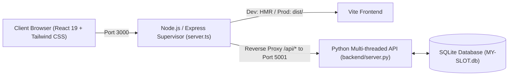

# MY-SLOT — Smart Parking & EV Charging Reservation System

Real-time car parking and EV charging slot reservation system featuring an interactive radar map, spot-level floor selector, Stripe & UPI payment integration, gate entry PIN generator, automated email receipt dispatcher, and a role-based Admin Management Portal.

---

## Architecture Overview



- **Frontend:** React 19, TypeScript, Tailwind CSS, Lucide Icons, Vite.
- **Supervisor & Reverse Proxy:** Express server managing process lifecycles, healthchecks, and serving frontend bundles.
- **Backend API:** Multi-threaded Python server (`ThreadingHTTPServer`) with SQLite persistence, zero external pip dependencies.
- **Security:** Salted PBKDF2 password hashing, HMAC-SHA256 JWT tokens, and RBAC admin controls.
- **Integrations:** Live Stripe API with sandbox fallback, real SMTP email dispatcher with in-app simulation fallback.

---

## 1. Quick Start (Local Development)

### Prerequisites
- **Node.js**: 20.19+ (or 22.12+)
- **Python**: 3.10+ (available on `PATH`)

### Run on Windows
```powershell
npm.cmd install
npm.cmd run dev
```

### Run on Linux / macOS
```bash
npm install
npm run dev
```

Open <http://localhost:3300> in your browser. The database initializes automatically at `backend/MY-SLOT.db` on first launch.

The Express server loads settings from `.env` and starts the Python API, which stores users, garages, spots, and bookings in SQLite. If you create `.env` from `.env.example`, keep `NODE_ENV=development` for local use. Use the same running server URL in every browser and sign in with the same account; each browser stores only its own login token.

If the app reports that the API is unavailable, run `npm run dev` from the project root and use <http://localhost:3000>. Do not open `index.html` directly or deploy only the static `dist` folder: those options do not run the database API.

### Configure Google Maps

1. In Google Cloud Console, create/select a project, enable billing, and enable **Maps JavaScript API**.
2. Create an API key and restrict it to your website referrers (for local development, add `http://localhost:3000/*` and `http://localhost:3300/*`; add your deployed domain for production). Restrict the key to **Maps JavaScript API**.
3. Copy `.env.example` to `.env` if you have not already, then set `VITE_GOOGLE_MAPS_API_KEY=your_key`. Do not commit `.env`. `VITE_` values are included in browser code, so rely on website/API restrictions rather than treating this key as a server secret.
4. Restart the app with `npm run dev`.

The interactive map and garage markers use Google Maps. If the key is missing or Google rejects it, the map displays a configuration error. Google Maps billing and usage charges may apply.

---

## Deploying the Frontend to Vercel

Vercel serves the React frontend, but it does not run this project's long-lived Python API process or provide persistent local SQLite storage. Deploy the full MY-SLOT service (Node + Python + SQLite) to a container host with a persistent disk, then point the Vercel frontend at that API.

1. Deploy this repository as a **Docker** web service on Render or Railway. Attach persistent storage at `/app/data` and set `DATABASE_PATH=/app/data/MY-SLOT.db`.
2. Configure the backend service environment variables: `NODE_ENV=production`, a stable private `JWT_SECRET`, a private `ADMIN_SECRET_KEY`, `DATABASE_PATH=/app/data/MY-SLOT.db`, and `CORS_ORIGIN` set to your Vercel site's exact origin (for example, `https://your-project.vercel.app`, without a trailing slash). Keep both secrets on the backend only.
3. Wait for the backend deployment, then open `https://YOUR-BACKEND-HOST/api/health`. It should return JSON with `"status":"ok"`.
4. In the Vercel project settings, set `VITE_API_BASE_URL` to the backend origin only (for example, `https://your-project.onrender.com`, with no `/api` suffix). Set any other frontend build-time values there, such as `VITE_GOOGLE_MAPS_API_KEY`.
5. Redeploy the Vercel frontend so Vite includes the API URL in the build. Test sign-up/sign-in from the deployed site.

The browser sends API requests directly to the backend, so the backend's `CORS_ORIGIN` must match the frontend origin. If you use Vercel preview domains, add the origins you need to `CORS_ORIGIN` as a comma-separated list, or test through your stable production domain. Do not set `VITE_API_BASE_URL` to the Vercel site itself; that would send API requests back to the static frontend.

---

## 2. Production Deployment with Docker (Recommended)

The easiest and most reliable way to run MY-SLOT in production is using Docker, which automatically configures both Node.js and Python runtimes with a persistent database volume.

### Step 1: Clone and configure environment
```bash
cp .env.example .env
# Edit .env and replace JWT_SECRET and ADMIN_SECRET_KEY with unique, private secrets
```

### Step 2: Launch the container
```bash
docker compose up -d --build
```

- Application runs at: `http://localhost:3000`
- SQLite database persists in the named Docker volume `my-slot-data` at `/app/data/MY-SLOT.db` across reboots and image upgrades.
- The Compose file requires both `JWT_SECRET` and `ADMIN_SECRET_KEY`; use strong, private values and keep `JWT_SECRET` unchanged across restarts. `ADMIN_SECRET_KEY` creates the single owner account; garage admins are assigned by the owner.

### Stop container:
```bash
docker compose down
```

---

## 3. Deploying to Cloud Platforms

### A. Deploy to Render (Web Service)
1. Fork or push this repository to GitHub.
2. In the Render Dashboard, create a **New Web Service** and connect your repository.
3. Select **Environment: Docker**.
4. Add a **Persistent Disk** (Render Disk):
   - **Mount Path:** `/app/data`
   - **Size:** 1 GB
5. Configure Environment Variables in the Render dashboard:
   - `NODE_ENV=production`
   - `DATABASE_PATH=/app/data/MY-SLOT.db`
   - `JWT_SECRET=<generate_a_random_32_char_secret>`
   - `ADMIN_SECRET_KEY=<your_private_owner_passcode>`
6. Deploy! Render will build the Dockerfile and launch the service.

### B. Deploy to Railway
1. Create a **New Project** from your GitHub repo.
2. Add a **Persistent Volume** mounted to `/app/data`.
3. Add the environment variables (`JWT_SECRET`, `ADMIN_SECRET_KEY`, `DATABASE_PATH=/app/data/MY-SLOT.db`).
4. Railway detects the `Dockerfile` and deploys automatically.

### C. Deploy to Linux VPS (Ubuntu / Debian / AWS EC2)
```bash
# 1. Install Node.js 20 and Python 3
curl -fsSL https://deb.nodesource.com/setup_20.x | sudo -E bash -
sudo apt-get install -y nodejs python3 python3-pip

# 2. Clone repository & install dependencies
git clone <repo-url> /opt/my-slot
cd /opt/my-slot
npm install

# 3. Build frontend bundle
npm run build

# 4. Set production environment variables
export NODE_ENV=production
export JWT_SECRET="your-strong-random-key"
export ADMIN_SECRET_KEY="your-private-owner-code"
export DATABASE_PATH="/opt/my-slot/backend/MY-SLOT.db"

# 5. Start with PM2 process manager
sudo npm install -g pm2
pm2 start server.ts --interpreter ./node_modules/tsx/dist/cli.mjs --name my-slot
pm2 save
pm2 startup
```

---

## 4. Environment Variables Reference

| Variable | Required | Default | Description |
| :--- | :---: | :---: | :--- |
| `PORT` | No | `3000` | Port for the Node.js reverse proxy & frontend server. |
| `PYTHON_PORT` | No | `5001` | Internal port for the Python backend API. |
| `NODE_ENV` | Yes (in prod) | `development` | Set to `production` for production builds. |
| `DATABASE_PATH` | No | `./backend/MY-SLOT.db` | Absolute or relative path to the SQLite database file. Mount a persistent disk volume here in containerized deployments. |
| `JWT_SECRET` | **Yes (in prod)** | - | Secret key used to sign session JWTs. Must be a secure random 32+ character string. |
| `ADMIN_SECRET_KEY` | **Yes (in prod)** | - | Private passcode used once to register the single `owner` account. The owner assigns each `admin` to one garage. |
| `CORS_ORIGIN` | No | `*` | Allowed CORS origins (e.g. `https://yourdomain.com`). |
| `VITE_API_BASE_URL` | Required for Vercel frontend | Same origin in local development | Public origin of the separately deployed backend, with no `/api` suffix. Configure in the frontend build environment. |
| `VITE_GOOGLE_MAPS_API_KEY` | Optional | - | Browser Maps JavaScript API key. Restrict it to your frontend domains. |
| `STRIPE_SECRET_KEY` | Optional | - | Stripe Secret Key (`sk_test_...` or `sk_live_...`). If empty, runs in sandbox simulation mode. |
| `SMTP_HOST` | Optional | - | SMTP Server host (e.g. `smtp.gmail.com`, `smtp.sendgrid.net`). If empty, emails are stored locally. |
| `SMTP_PORT` | Optional | `587` | SMTP port (e.g. 587 for TLS, 465 for SSL). |
| `SMTP_USER` | Optional | - | SMTP username or API key. |
| `SMTP_PASSWORD` | Optional | - | SMTP password or API token. |
| `SMTP_FROM` | Optional | `bookings@my-slot.app` | Sender email address for booking confirmations. |
| `SMTP_USE_TLS` | Optional | `true` | Whether to enable STARTTLS for SMTP connections. |

## Owner and Garage Admin Access

1. Set a private `ADMIN_SECRET_KEY` on the server and create the owner account from the registration form using that key. The key is only accepted for the first owner account.
2. The owner creates garages in the owner console, then uses **Users & RBAC** to assign an existing user to a garage as its admin.
3. A garage admin can manage that garage's spots, bookings, and operational information only. Admins cannot claim garages, create/delete garages, or manage users.
4. To remove an admin, the owner selects **Demote to User**. The garage becomes unassigned and can be assigned to another admin.
5. The owner can block an account to immediately revoke login and release an admin's garage. Unblocking restores login but does not reassign the garage; the owner must assign it again. Deleting an account removes its access and anonymizes customer details in retained booking/notification records; payment and audit history is preserved.

Phone number is required for every new account and must be unique. Users can sign in with either their email address or phone number. Older accounts without a phone number can still sign in by email; the owner can require those account holders to create a new account or provide a separate account-update workflow.

Existing accounts with role `admin` remain garage admins and keep their existing garage assignment; they are not automatically promoted to owner. For an existing admin account that should become the owner, back up the database and run this SQL once in DB Browser for SQLite, replacing the email:

```sql
UPDATE parking_locations
SET owner_id = NULL
WHERE owner_id = (SELECT id FROM users WHERE email = 'owner@example.com');

UPDATE users
SET role = 'owner'
WHERE email = 'owner@example.com' AND role = 'admin';
```

---

## 5. Security Checklist for Production

- [x] Multi-threaded request processing enabled (`ThreadingHTTPServer`).
- [x] Owner secret is loaded via `ADMIN_SECRET_KEY`; admins cannot self-register or use the owner secret.
- [x] Random secret generation and warnings if `JWT_SECRET` is unset in production.
- [x] Ephemeral database loss prevented via configurable `DATABASE_PATH` and Docker volume mapping.
- [x] Live Stripe API support enabled via `STRIPE_SECRET_KEY` with graceful sandbox fallback.
- [x] Real SMTP email delivery supported via `SMTP_HOST` with graceful in-app fallback.
- [x] Zero-vulnerability production Dockerfile with health checks.
